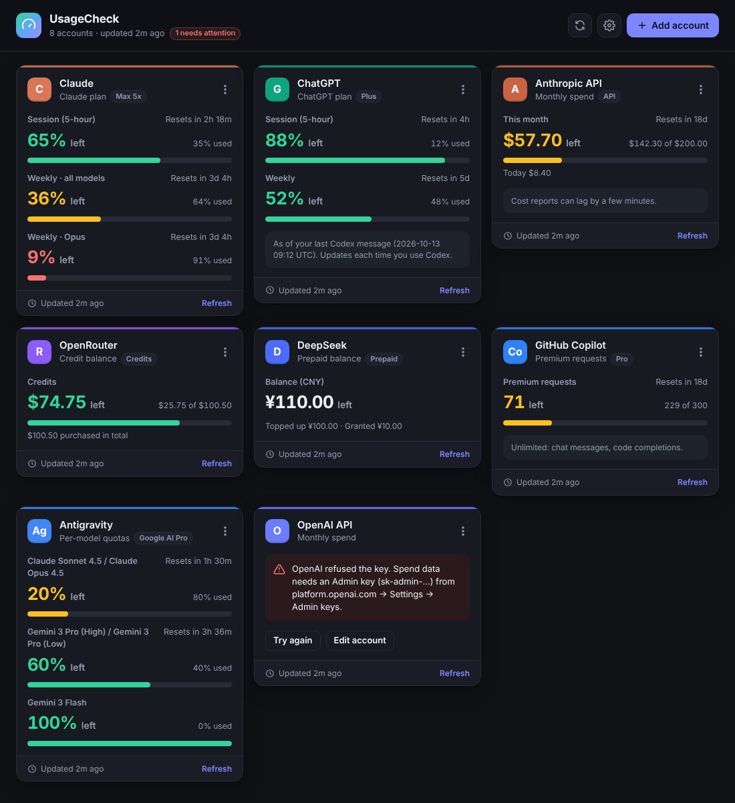

# Quota

A small, fast Windows app that shows how much usage is left on your AI accounts, all in one window and in the system tray.



The taskbar widget, next to the clock:


| Account | What you see | How it connects |
| --- | --- | --- |
| **Claude plan** (Pro / Max) | 5-hour session and weekly limits, with reset times | Reads the sign-in from [Claude Code](https://claude.com/product/claude-code) on your PC. Nothing to paste. |
| **ChatGPT plan** (Plus / Pro) | Live 5-hour and weekly Codex limits, with reset times | Reuses the ChatGPT sign-in from the [Codex CLI](https://developers.openai.com/codex/cli) on your PC. Nothing to paste. |
| **Anthropic API** | Spend this month, and what's left of your budget | Admin API key (`sk-ant-admin…`) |
| **OpenAI API** | Spend this month, and what's left of your budget | Admin API key (`sk-admin-…`) |
| **OpenRouter** | Credits left | API key (a management key shows the whole account) |
| **DeepSeek** | Prepaid balance | API key |
| **GitHub Copilot** | Premium requests left this month (plus chat and completions on Free), with the reset date | Reuses the GitHub sign-in from Copilot for JetBrains / Visual Studio / Vim or the [GitHub CLI](https://cli.github.com/) (`gh auth login`). You can also paste a token. |
| **Cursor** | Included plan usage this billing cycle (overall, Auto, named models) and on-demand spend, with the reset date | Reuses the [Cursor CLI](https://cursor.com/cli) sign-in (`cursor-agent login`), or a cursor.com session cookie you paste. The Cursor editor's own storage isn't read. |
| **Antigravity** | Quota left for each model group, with reset times, plus prompt credits | Reads the quota from [Antigravity](https://antigravity.google/) while it's running on your PC. Nothing to paste, and nothing leaves your computer. |

> **Why the ChatGPT and Claude plans work this way:** neither OpenAI nor Anthropic offers a public API for consumer plan limits. Quota calls the same usage endpoints their own command-line tools use (Claude Code's `/usage`, Codex's `/status`). These endpoints are undocumented, so either company could change them at any time.
>
> GitHub Copilot's quota endpoint is also internal. If it refuses your token (fine-grained tokens usually can't use it), Quota switches to GitHub's official billing API. That needs a fine-grained token with the **Plan (read)** account permission, and only reports requests *used*, so you also enter your monthly allowance (e.g. 300 for Pro).
>
> Antigravity has no web API for quotas. Quota asks the Antigravity app on your PC, the same way the app's own quota display does, so Antigravity has to be open. When it's closed, the card keeps the last values it saw and says so.
>
> For ChatGPT, if the live call isn't possible (for example Codex keeps its sign-in in the OS keyring instead of `~/.codex/auth.json`, or the sign-in has expired), Quota falls back to the limits Codex saved in its session logs after your last message, and says so on the card.

## Install

1. Download the latest installer, `Quota_x.y.z_x64-setup.exe`, from the repository's **Releases**. Before releases are set up, you can also get it from the newest green **Build** run in the **Actions** tab, as the `Quota-windows` artifact.
2. Run it. It installs just for you, so no admin rights are needed.
3. Click **Add account**. Anything found on your PC (Claude Code, Codex, Copilot, Antigravity) is offered in one click.

To see your plan limits:
- **Claude:** install Claude Code and run `claude` once to sign in. If the token expires, opening Claude Code renews it.
- **ChatGPT:** install Codex CLI and run `codex login` with your ChatGPT account. The card then updates live on every refresh. If the sign-in expires, running `codex` once renews it.
- **Copilot in VS Code:** VS Code keeps its GitHub sign-in in its own protected storage, which Quota deliberately doesn't read. In the Copilot account, click **Sign in with GitHub** once. This opens GitHub's official CLI sign-in; use the same GitHub account as VS Code. Copilot in JetBrains, Visual Studio or Vim is picked up automatically.
- **Antigravity:** the app or editor extension is read while it's open. With the Antigravity CLI (`agy`), Quota runs its own usage report (`agy -p /usage --output-format json`), at most every 5 minutes; just make sure you've signed in to `agy` once.

## Automatic updates

Every push to the default branch builds a new version (`0.1.<build number>`), signs it and publishes it as a GitHub Release. The app checks every 5 minutes and updates itself silently: there's no prompt or installer window. If you're using the Quota window at that moment, it waits (up to an hour) until you're done, then installs and restarts. If it was in the tray, it restarts in the tray. Updates are always on; Settings → Updates shows the status and has a **Check now** button. An update is only installed if its signature matches the public key built into the app.

Quota used to be called UsageCheck. Updating from UsageCheck installs Quota and then silently removes the old UsageCheck copy; your accounts, keys, settings and "start with Windows" choice carry over.

One-time setup in the GitHub repository (**Settings → Secrets and variables → Actions**):

1. Add the secret **`TAURI_SIGNING_PRIVATE_KEY`** with the contents of the private key file.
2. Add the secret **`TAURI_SIGNING_PRIVATE_KEY_PASSWORD`** with its password.
3. Make sure the app can download releases. The installed app downloads updates without logging in to GitHub, so the releases must be public. Choose one:
   - make this repository public, or
   - keep it private and publish releases to a separate **public** repository:
     1. Create it (for example `usagecheck-releases`) with a README so it isn't empty.
     2. Add a variable **`RELEASE_REPO`** = `devbehkame/usagecheck-releases`.
     3. Add a secret **`RELEASES_TOKEN`**: a fine-grained personal access token with **Contents: read and write** on that repository.

Until the signing secrets exist, builds still run and produce installers, but no release is published.

## Security

- **Keys live in Windows Credential Manager**, which encrypts them with DPAPI under your Windows account. They are never written to the app's config file.
- **The interface never sees your keys.** All network calls happen in the Rust backend. The web UI only gets the usage numbers back, and it renders them as plain text (no `innerHTML`), so a provider response can't inject markup.
- **Your Claude, Codex and GitHub sign-ins are only read.** Quota never refreshes or rewrites them, so those tools keep working normally. Each is sent only to its own service (api.anthropic.com, chatgpt.com, api.github.com).
- **Antigravity stays on your PC.** Quota only talks to Antigravity's local server on `127.0.0.1`, using the per-session token Antigravity gives it on its command line. That local server uses a self-signed certificate, so certificate checks are off for that one loopback connection only. Nothing goes over the internet.
- **Network access is locked down:** HTTPS only, no redirects followed, strict timeouts, and each key goes only to its own provider's host. Requests follow your Windows proxy setting (so a VPN or proxy app that sets it works), and certificates trusted by Windows are accepted alongside the built-in list.
- **Least-privilege Tauri setup:** a strict Content-Security-Policy, a frozen JS prototype, and only the permissions the UI needs. Links open only for an allow-listed set of provider sites.
- **No telemetry, no analytics, no accounts.**

## Features

- Every account on one dashboard, coloured green, amber or red by how much is left.
- Reset countdowns ("Resets in 2h 18m"). Hover one for the exact time.
- Requests are paced so providers aren't hammered. Automatic checks never ask one account more than once a minute, a repeat **Refresh** click within 20 seconds reuses the last result, and if a provider says "too many requests", Quota keeps showing the last numbers and waits 5 minutes (doubling up to 30) before asking again.
- Auto-refresh (off, or every 1–60 min) runs in the background, so the tray and taskbar widget stay current even when the window is closed to the tray. There's also a refresh of anything older than a minute when you bring the window back. Ctrl+R / F5 refreshes now.
- **Taskbar widget:** your chosen accounts sit on the taskbar next to the clock, each as its icon plus how much is left (e.g. `C 65%  G 88%`), coloured green, amber or red. In Settings → Taskbar widget, add as many slots as you like (up to 8) and pick an account for each, showing either its tightest limit or a specific gauge. The same account can appear twice (e.g. Claude's weekly limit). It sits in free taskbar space next to the clock and moves aside so it never covers your app buttons; if the taskbar is full, it floats just above the clock. Click it to open Quota, or drag it anywhere; "Dock to clock" puts it back. It hides while a full-screen app or game is in front, follows the taskbar's light or dark colour, and can also be toggled from the tray menu.
- Drag any card to reorder the dashboard; the order is remembered.
- **Hover card:** rest the pointer on a widget item to see that account's full card, with every limit, its reset time and notes, just like in the app.
- Each card shows which account it is signed in as (email or GitHub username) for Claude, ChatGPT, Copilot and Antigravity, read from the same sign-in Quota already uses.
- Tray icon: hover it to see each account's tightest limit; right-click it to refresh, toggle the taskbar widget, or quit.
- Starts with Windows (minimized to the tray); turn it off in Settings. If the startup entry goes missing, for example after running the setup again, Quota adds it back the next time it starts.
- Light, dark or system theme.
- A **Test connection** button before you save a key.

## Development

Requirements: Rust (stable), Node 20+, and the [Tauri prerequisites](https://v2.tauri.app/start/prerequisites/) (on Windows, WebView2 and the MSVC build tools).

```sh
npm install
npm run tauri dev       # run with hot reload
npm run tauri build -- --config '{"bundle":{"createUpdaterArtifacts":false}}'   # installers without update signing
cargo test --workspace  # provider parsing tests
```

Layout:

```
crates/usage-core/   Provider clients and parsing (pure Rust, unit-tested, no UI)
src-tauri/           Desktop shell: commands, Credential Manager, tray, config
src/                 UI (TypeScript + CSS, no framework, ~25 KB)
```

Adding a provider means one file in `crates/usage-core/src/providers/`, one enum variant, and one entry in `src/providers.ts`.

## Why Tauri + Rust

- **Small and fast:** the installer is a few MB and idles at a fraction of an Electron app's memory. It uses Windows' built-in WebView2.
- **Secure by construction:** the memory-safe Rust backend holds the secrets. The sandboxed UI only gets the permissions it needs.
- **Nice UI:** the web stack makes a polished interface easy, and it still feels native (tray, autostart, single instance).

## Credits

Provider logos come from [LobeHub Icons](https://github.com/lobehub/lobe-icons) (MIT). Claude, ChatGPT, OpenAI, Anthropic, GitHub Copilot, Antigravity, OpenRouter and DeepSeek are trademarks of their owners; their logos are used only to identify each service.
